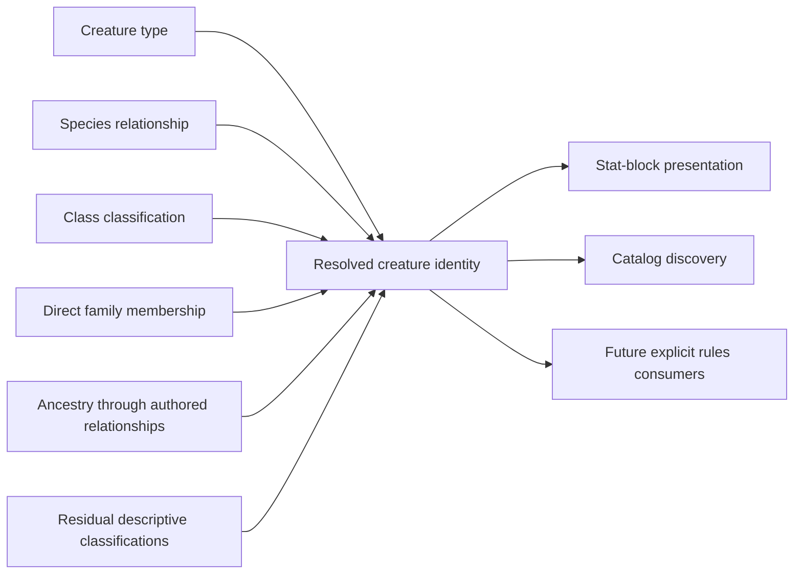

# Creature identity and heritage roadmap

**Status:** Lightweight monster classification slice implemented; broader identity/heritage directions remain proposals.  
**Last reviewed:** 2026-11-14  
**Purpose:** Long-term ownership and product direction. Detailed tasks belong in implementation plans.

## Source-of-truth hierarchy

1. Runtime contracts and registered reference policies describe shipped behavior.
2. This roadmap records the proposed direction, boundaries, and deferred decisions.
3. Working plans sequence implementation: `.cursor/plans/creature_descriptive_tags_258586d6.plan.md`, `creature_taxon_consumer_follow_ups.plan.md`, and `target_eligibility_selectors_89bb4df5.plan.md`. These local plans are Git-ignored and are not required to understand this document.

Related policy: [content types](../content-types.md), [content versus vocabulary](./content-types-roadmap.md), [campaign vocabulary](../vocabulary.md), [monster stat blocks](../../packages/contracts/docs/monster-stat-blocks.md), [Organization taxonomy](./organization-taxonomy.md).

## Current implementation boundary

The first implementation is intentionally limited to the existing `creatureType` plus optional `creatureFamilyIds` and `classIds`, authored in monster edit and rendered as `Creature Type (classification)` in detail/stat-block/edit-preview views.

Families use lightweight vocabulary-backed definitions with `id`, `label`, optional `description`, optional `parentId`, and optional `allowedCreatureTypes`. Lycanthrope and Titan are Monstrosity-compatible families; Chromatic and Metallic are Dragon-compatible families. Class ids resolve existing class content without levels or grants. No separate lineage field, residual-tag field, species relationship, heritage change, general identity projection, or target predicate is required for this first slice.

Optional parent metadata has reference/cycle integrity but does not require hierarchy authoring, inherited membership, or ancestor-based display. A family content type and the broader ideas below remain possible future directions, not prerequisites for seeding or the monster form.

## Vision and guiding principles

Creature identity is a collection of distinct semantic relationships. A creature can have a rules type, an explicitly authored class classification, a species relationship, family membership, ancestry, and other identity facts without those relationships becoming interchangeable.

Reuse authoritative definitions when a relationship has meaningful shared utility. Classes and species already have catalogs; families can begin as lightweight definitions and may warrant a content catalog later if broader authoring and heritage use justify promotion. Residual descriptive classifications remain useful when a dedicated domain adds little value. No domain is promoted merely to remove a few tags.

Keep identity, capabilities, mechanics, and presentation separate. A class reference need not grant levels; a species reference need not grant playable traits; family membership need not confer an element or resistance. A transformation action does not assign Shapechanger classification. Source-assigned classifications are explicit evidence, not inferred capabilities.

Definitions and authored relationships stay with their owning domains. Shared resolution and presentation can bring them together without a universal identity-reference persistence model. Homebrew definitions, campaign overrides, access policy, and edition/setting differences must participate in resolution from the beginning.

## Current foundations and gaps

- Monster contracts include optional `creatureFamilyIds` and `classIds`, with monster edit controls and shared type-line display. Families are vocabulary-backed definitions; species relationships and broader identity/heritage work remain deferred. There is no legacy creature subtype migration.
- Class content and character class progression are separate existing responsibilities. Organization member class/species affinities demonstrate lightweight content references, although affinities are not identity membership.
- Species is currently playable ancestry content. Heritage is an embedded named choice with local option ids, traits, grants, and availability. Character records retain species and selected heritage ids; they do not provide immutable historical mechanics.
- Species culture/naming configuration and Organization content already exist. Locations already include planes. Future work must build on those owners rather than assume blank-slate culture, faction, or origin models.
- Equipment attunement restrictions are presently prose beside a boolean. Classification references would provide inputs to a future consumer, not complete typed attunement eligibility.
- Shared target requirements already support AND across rows, explicit multi-value rules, and shared phrase composition. Target eligibility Slices 1–3 stay complete. This initiative does not add play-time enforcement.

## Potential domains and ownership

| Domain                                | Direction                                                                      | Status / boundary                                                                                    |
| ------------------------------------- | ------------------------------------------------------------------------------ | ---------------------------------------------------------------------------------------------------- |
| Creature type                         | Existing rules vocabulary                                                      | Independent authoritative classification; never inferred from family or ancestry.                    |
| Class classification                  | References to existing class definitions                                       | Near-term candidate for monster identity/discovery, without progression or grants.                   |
| Species relationship                  | Optional reference to an exact existing species definition                     | Useful where appropriate; broader species-concept equivalence remains open.                          |
| Creature families                     | Lightweight vocabulary-backed definitions, with optional parent metadata       | First slice; content-type promotion and hierarchy consumers are deferred.                            |
| Lineage / ancestry                    | Explicit relationships to families where appropriate                           | Prefer one family catalog over overlapping taxonomy and lineage catalogs.                            |
| Heritage                              | Existing species-owned choices and grants                                      | Add shared-definition links without replacing local choices.                                         |
| Life stages / variants                | Distinct classification and variant relationships                              | Exploratory; names are not a runtime source of identity.                                             |
| Cultures / traditions                 | Extend existing culture/naming foundations if standalone records are justified | Cross-species cultural membership is possible; species does not determine culture.                   |
| Factions / affiliations               | Existing Organizations and connections                                         | No parallel faction catalog by default.                                                              |
| Occupations / social roles            | Audit existing NPC roles/templates before introducing new vocabulary           | Exploratory; occupation is neither class membership nor species.                                     |
| Geographic / planar origin            | Relationships to Location definitions                                          | Exploratory; origin does not determine creature type or affiliation.                                 |
| Transformations / acquired identities | Dedicated model only when a concrete consumer needs it                         | No automatic classification from traits, names, or capabilities.                                     |
| Residual descriptive tags             | Flat explicit vocabulary                                                       | Reserved for classifications without a stronger useful owner; no duplicate authoritative membership. |

These are boundaries and candidates, not a commitment to implement every domain.

## Representative use cases

**Dragon families shared by monsters and Dragonborn.** An Adult Red Dragon can belong directly to a Red Dragon family beneath Chromatic. A Dragonborn's selected local heritage option can reference that same family as ancestry while remaining Humanoid. Both consumers keep their own mechanics. Parent-child hierarchy supports discovery; it does not transfer immunity, breath damage, or recharge rules.

**Giant families shared by monsters and Goliath.** A Fire Giant can have direct family membership. A Goliath heritage boon can reference that family as ancestry while retaining its own stable option id and benefit. Elemental affinity alone cannot express all giant ancestry benefits.

**Class-restricted magic items.** Monster class classifications and character class entries could supply distinct evidence to a future item prerequisite resolver. It must separate class membership from spellcasting capability and apply the selected ruleset's policy. Similar spells do not establish membership automatically.

**Species-specific effects and prerequisites.** An exact species reference can support related-content navigation and narrowly defined selection. It cannot silently stand for every playable definition of an underlying species. Missing playable equivalents and generic monsters remain valid without a reference.

**Monster life stages and variants.** Wyrmling, Young, Adult, and Ancient could relate otherwise distinct monster records for browsing without becoming a family ancestry axis or deriving statistics from age.

**Cultures across species.** A culture may connect unrelated species and individuals, using existing naming and culture foundations. Species-specific defaults are not universal cultural membership.

**Campaign ancestry and affiliation.** Homebrew family definitions can appear as heritage authoring candidates. Organization membership can express guilds or religious orders separately from class and species. Changes must be reviewable before they affect published choices.

**Hierarchical catalog discovery.** A family branch can find its direct and descendant members. An ancestry search must be separate; a query for Dragon family members must not include Dragonborn merely because a heritage option points to Red Dragon.

## Shared identity resolution and presentation

A small resolved identity read model could expose distinct relationships and resolution diagnostics to presentation, discovery, and future rule consumers. It would consume resolved domain definitions, not own a parallel set of identity records.

A rules consumer must select the relationship it means. Direct family membership may be matched exactly or through descendant membership when explicitly requested. Ancestry is a separate input, not another way to satisfy membership. Unknown or inaccessible definitions remain unresolved, not false or silently absent.

A stat-block subtitle is a source-aware projection. Classifications from different owners can reproduce printed parentheticals without duplicating them as editable tags. Not every identity relationship prints: an ancestry link or species reference need not appear. A Red Dragon family leaf does not by itself specify whether Chromatic, Red Dragon, or no family label belongs in a source's type line. Explicit presentation policy must resolve that question without a second subtype string.

## Architecture considerations

**Content ownership and promotion.** Families should become first-class content only with standalone authoring, cross-domain reference, hierarchy, and availability needs. Follow existing content envelopes, integration manifests, lifecycle, search, usage and authoring conventions. A simple optional parent is sufficient initially; no general graph or universal classification facets.

**Reference integrity.** Use opaque ids and registered reference edges. Guard deletion and destructive edits across monster memberships, hierarchy, heritage options, and future predicates. Validate effective campaign-resolved hierarchies, including override-induced cycles. Do not repair missing parents by silently changing ancestry.

**Edition, setting, and campaign context.** The same label can represent different rules definitions. Parent relationships and identity comparisons must resolve within a supported context; matching by name is unsafe. Distinguish whether a record is readable, referenceable, campaign-available, or playable. A species unavailable for character creation can still be meaningful identity metadata under an explicit access policy.

**Explicit versus dynamic heritage options.** Start with explicit embedded options that may reference a family. Branch selectors can help authors discover candidates and deliberately materialize choices. A new descendant must not automatically expand a published species's options. Fully dynamic sets need separate source/revision, ordering, availability, grant-completeness, and stability decisions.

**Existing character stability.** Stable ids preserve references but do not freeze changed grants or hierarchy. Do not silently replace selected heritage options, drop references, or recalculate choices from a moved branch. Retain diagnostics and require explicit reconciliation for unavailable or changed selections. Historical mechanical stability may eventually require revisions or snapshots; that is an open design decision rather than a guarantee of the current model.

**Shared characteristics versus mechanics.** A typed Fire affinity may eventually be a useful shared family fact. Monster immunity and species resistance remain separately authored consumer mechanics. Defer generalized attributes, parameterized grants, and inheritance until concrete consumers justify them.

## Direction and sequencing

The current first slice is defined above and supersedes the broader implementation sequence previously proposed. The following describes possible expansion after that slice, not required checkpoints before it.

First establish the ownership and source-disposition ledger. Then deliver a small usable slice of existing class/species relationships and residual classifications. Family definitions and monster membership can follow as one complete content slice. Explicit family links on heritage options follow once reference and stability policies exist.

Concrete target requirement predicates may arrive as their own dependencies become available. They need not wait for every heritage feature or every proposed identity axis. Attunement, prerequisites, and other rules consumers require their own typed policy; they are not implicitly included in target authoring work.

Keep detailed tasks, fixtures, and phase completion status in implementation plans. Full repository gates run at user-requested commit/push checkpoints, not at every architectural milestone.

## Open decisions and deferred capabilities

- Does authored monster class classification count as class membership for a particular rules consumer, and what evidence is required per edition?
- When is an exact playable species definition sufficient, and when would a separate species-concept identity be justified?
- Which family candidates provide enough reuse to warrant records, especially Titan, Angel, Dinosaur, and acquired classifications?
- How should source-appropriate printable family/class labels be selected while preserving homebrew authoring?
- How should disabling or reparenting a family affect new authoring, existing references, branch discovery, and future hierarchical predicates?
- What stability guarantee is required for existing character mechanics when species definitions change?
- Can branch-backed heritage ever be dynamic, or should publication always materialize explicit options?
- Which shared characteristics have multiple real consumers, rather than anticipated utility?

Deferred: dynamic heritage expansion, cross-edition equivalence, a comprehensive taxonomy engine, multiple-parent graphs, generalized attribute/grant inheritance, full lifecycle simulation, standalone culture/occupation/transformation systems, new faction infrastructure, attack/effect gates, and play-time eligibility enforcement.
