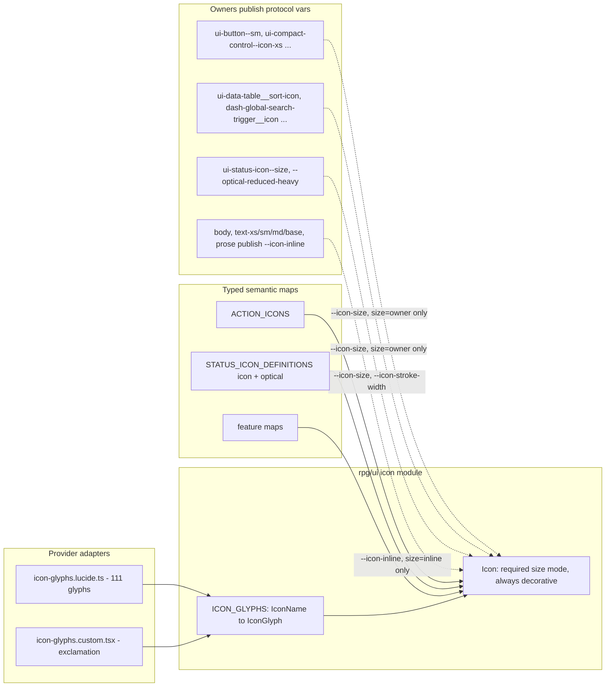

# Unified icon architecture

Status: **Phases 1–5 complete.** Phase 6 (strict gate and legacy deletion) is not started.

| Phase | Scope                                                                                      | Status  |
| ----- | ------------------------------------------------------------------------------------------ | ------- |
| 1     | Foundation: census, scale, `Icon` module, ESLint baseline, bundle                          | Done    |
| 2     | Owner protocol, StatusIcon (`exclamation`)                                                 | Done    |
| 3     | Semantic maps, `ActionIcon` / `ActionButton` / fallback icon                               | Done    |
| 4     | `@rpg/ui` controls, `Spinner`, `DisclosureIndicator`, sizing exempt list cleared           | Done    |
| 5     | Dashboard and bench call sites; identity/size tests                                        | Done    |
| 5b    | Post-migration census snapshot refresh; empty provider baseline (glyph adapters only)      | Done    |
| 6     | Transitional rule, legacy utilities, `lucide-react` in dashboard/bench, docs, strict gates | Pending |

Phase 1 records the geometry census, the glyph-scale rename, the `Icon` module, the binding-level ESLint baseline, and the bundle measurements below. Phases 2–5 are judged against that census; snapshots were refreshed after the control and app migrations (`chore(icons): refresh storybook geometry census snapshots`).

## Phase 1 record

### Registry

The import census finds 117 Lucide value names and 112 distinct components. The custom `exclamation` glyph is additional (Lucide 1.17 has no bare exclamation), so `ICON_GLYPHS` has 113 names: 112 Lucide components plus `exclamation`. The plan's "111 + 1" figure treated `exclamation` as a replacement for a Lucide component; `circle-alert` is still imported outside StatusIcon, so it stays in the registry.

### Bundle

Measured Oct 23, 2026. esbuild `--bundle --minify --format=esm --external:react`, then gzip -9.

| Bundle                                      | Minified |  gzip -9 |
| ------------------------------------------- | -------: | -------: |
| Full registry (`icon-glyphs.ts`, 113 names) | 34,675 B | 10,598 B |
| 1 Lucide glyph                              |  2,245 B |  1,097 B |
| 10 Lucide glyphs                            |  4,312 B |  1,804 B |

Marginal cost after the first glyph is about 85 B gzipped: `(10598 − 1097) / 112`.

**Public** (`pnpm --filter @rpg/public build`, Next.js 16.2.7). The client chunk `apps/public/.next/static/chunks/312f8rqyear2f.js` is 1,182,039 B raw and 322,596 B gzip. It contains the custom `exclamation` glyph and Lucide `link-2`, which the public app does not import except through the registry. The `ui-icon` class string is absent, so the `Icon` function was dropped and the glyph modules stayed in the shared UI chunk. This Next version did not print per-route first-load JS. `lucide-react` is removed from `apps/public`.

**Dashboard** (`pnpm --filter @rpg/dashboard build`, Vite 8). `index-DSbKkHM2.js` is 2,242,993 B raw and 563,707 B gzip. `src-DaqhK_u6.js` is 1,054,744 B raw and 294,220 B gzip and contains the Lucide icons the dashboard already imports. The custom `exclamation` glyph is not in that build. Nothing in the dashboard imports `Icon` yet, so the registry did not land in the production bundle.

### StatusIcon screenshots

Light and dark matrices of the six variants at sm, md, and lg, captured before the glyph change:

- [status-icon-matrix-light.png](unified-icon-architecture/status-icon-matrix-light.png)
- [status-icon-matrix-dark.png](unified-icon-architecture/status-icon-matrix-dark.png)

Needs-attention still draws the circled exclamation. Phase 2 compares against these.

### Geometry census

`postVisit` records identity, width, height, and stroke-width for every `svg`. Unresolved `size="owner"` fails the story. Each snapshot also includes Storybook's hidden `#storybook-a11y-vision-filters` svg (`width` and `height` `auto`, stroke `1px`).

UI Storybook (`test-storybook -u` against the static build on port 6006): 177 suites, 844 tests, 760 snapshots written. 34 suites and 84 tests failed existing play or addon-a11y checks, so those stories have no geometry snapshot. None of the failures were an unresolved `--icon-size`. The `Icon` sizes story measures 10, 12, 14, 16, 20, 24, and 32 px. The owner story resolves at 16 px. The notification bell measures 20 px. Existing glyph stories that used the old 32 px step still measure 32 px.

Dashboard Storybook (static build, port 6027): 308 suites run, 250 passed, 58 failed, 3 skipped; 877 tests, 758 snapshots. Failures are existing play or addon-a11y checks, plus eight stories in `equipment-package-switch-resolution-modal` that did not load. None were an unresolved `--icon-size`. New owner stories: nav item 16 px at stroke 1.75, content-media fallback frames include 32 px, the master-detail empty state is 40 px, and the table-builder inset gate is 32 px with Lucide identity `table2`.

### Post phases 4–5 census refresh (Oct 23, 2026)

After migrating `@rpg/ui`, dashboard, and bench to `Icon` (`feat(icons): migrate ui controls and apps to Icon (phases 4-5)` and `chore(icons): refresh storybook geometry census snapshots`):

- **Provider baseline:** `icon-provider-baseline.json` is `{}`; only `icon-glyphs.lucide.ts` (and its test) may import Lucide.
- **UI Storybook** (`build-storybook` + `test-storybook:ci`, port 6006): **757 / 757** geometry census snapshots pass. `assertResolvedOwnerIconSizes` passes after explicit sizes on number-input steppers and drop-target browse, plus owner element class on comfortable drop-target icons. Full `test-storybook:ci` still exits non-zero on pre-existing **axe** smoke failures (not census).
- **Dashboard Storybook** (port 6007): **753** geometry census snapshots updated for `data-icon` identities and owner sizing. Same axe/play failures as before; occasional census ordering drift may need sorted census output if CI flakes.
- **Phase 6 (done):** transitional CSS removed; legacy glyph utilities deleted; `icon-glyph.variants.ts` and ESLint baseline removed; `no-inline-svg` added; `lucide-react` removed from dashboard and bench; docs updated to the Icon guide.

# Unified Icon Architecture and Migration Plan

Planning only. All counts were taken on Oct 23, 2026 from `apps/*/src` and `packages/*/src`.

- **Automated** means the count came from a read-only `rg`, Node or `esbuild`-to-stdout script.
- **Manual** means I checked it by reading the code.

Each decision in this revision is tagged:

- **[reduces complexity]**
- **[preserves behavior]**
- **[fixes verified defect]**

**Guiding principle:**

- BEM classes (`ui-` in `@rpg/ui`, `dash-` in the dashboard) express component ownership and visual variation.
- Typed registries express glyph identity and semantic configuration.
- Design tokens express values.
- Three CSS custom properties work as _protocols_ that carry owner decisions to the glyph: `--icon-size`, `--icon-inline` and `--icon-stroke-width`.

There is one icon contract and one migration path: no compatibility exports, no alias keys and no parallel sizing system after Phase 6.

## 0. What changed in this revision

1. **Canonical names.**
   - 117 Lucide value names resolve to 112 components (automated identity check).
   - Each glyph gets exactly one hand-authored, provider-neutral `IconName`.
   - Four Lucide version-suffixed names are renamed: `trash`, `table`, `link-horizontal`, `settings-sliders`.
   - Tags: [reduces complexity] [preserves behavior].
2. **Sizing contract.**
   - `size` is **required**: `IconSize | 'inline' | 'owner'`.
   - There is no fallback for `owner`, so a missing owner fails the census instead of silently rendering 14px.
   - Tag: [reduces complexity].
3. **Scale extension for parity.**
   - 20px and 24px (4 owners each) become shared steps `xl` and `2xl`.
   - Today's 32px `xl` is renamed to `3xl` first, so no step name ever has two meanings.
   - 40px stays owner-specific because it has 1 owner.
   - Every design change proposed in the earlier revision (20→16, 40→32) is withdrawn.
   - Tag: [preserves behavior].
4. **Parity mapping rules.** Every legacy sizing form maps to exactly one size mode (section 6), so implementers don't re-decide anything. Tag: [preserves behavior].
5. **StatusIcon.**
   - `glyph: 'reduced'` becomes `optical: 'reduced-heavy'`, which names both inseparable properties.
   - The `exclamation` glyph is geometrically equivalent by construction, but it is verified visually, not assumed.
   - Tag: [reduces complexity].
6. **Enforcement.**
   - A binding-level baseline replaces the path-only baseline.
   - The CSS gate uses an owner registry plus resolver exclusivity tests, replacing the "no two modifiers" rule, which was wrong for mutually exclusive modifiers.
   - Tag: [reduces complexity].
7. **Accessibility.**
   - `Icon` is always decorative, and `aria-*`, `data-*`, `role`, `title` and `style` are typed `never`.
   - The `label` prop is dropped: it has 0 consumers, because Spinner owns its own `role="status"`.
   - Tags: [reduces complexity] [fixes verified defect]. The previous sketch let `aria-label` coexist with forced `aria-hidden`.
8. **Bundle.** The measured registry cost replaces the earlier estimate and the arbitrary 15 kB threshold (section 12).
9. **Tests.**
   - About 16 presence-only `querySelector('svg')` test files stay unchanged.
   - Only identity tests move to `[data-icon]` (section 13).
10. **Inventory corrections:**
    - 6 owner-element CSS rules that size the svg directly were missed. Total CSS sizing rules: 48.
    - Spinner is a 24px and 32px consumer.
    - The global search trigger is responsive (20px below `md`, 16px at `md` and up).
    - Sidebar stroke ownership is resolved.

## 1. Executive summary

**Main problems (unchanged in substance)**

1. **There are two incomplete registries.**
   - `@rpg/ui` has `ACTION_ICONS`, `RESOURCE_ICONS` and `CONTENT_DISPLAY_FALLBACK_ICONS`, typed `AppIcon = LucideIcon`.
   - The dashboard adds nine feature maps.
   - 163 production JSX sites import Lucide directly.
2. **Six sizing mechanisms compete:**
   - root utilities (`iconGlyphRootClasses`, `size-icon-glyph-*`)
   - descendant and direct-child helpers
   - `size-icon-inline`
   - 48 control/owner CSS rules
   - raw Tailwind (`size-4` appears 42 times)
   - Lucide's 24px attribute default for unsized icons
3. **StatusIcon has its own parallel system:**
   - 18 compound variants
   - stroke widths in TS constants
   - two single-purpose utilities
   - a redundant colour class
   - a `> circle` hack that depends on Lucide's internal SVG structure
4. **Glyph identity is mixed up with domain meaning.** 11 alias import names are spread across 18 files, plus 2 local renames in 2 more.
5. **Enforcement is partial.** Ban tests cover hand-picked lists, and the sizing ban covers `packages/ui` only.
6. **Verified defects:**
   - `ContentDisplayFallbackIcon`'s `size` prop does nothing: it puts `[&>svg]` classes on the svg itself.
   - `ActionIcon` silently defaults to `lg` (16px), even inside smaller buttons. This one is preserved, and flagged for later review.

**Recommended direction**

- `<Icon name="check" size="sm" />` renders `<svg class="ui-icon ui-icon--sm" data-icon="check" aria-hidden="true">`.
- `.ui-icon` is the only rule that declares glyph `width`, `height`, `stroke-width` and `flex-shrink`.
- **Size modes** (required prop):
  - A **step** means the icon owns its size.
  - **`inline`** means the typography owner sets it.
  - **`owner`** means the enclosing or same-element BEM owner sets it.
- **Owners publish `--icon-size` and `--icon-stroke-width`.** They come in two forms:
  - ancestor modifiers, such as `.ui-button--sm`
  - owner element classes on the icon itself, such as `.ui-data-table__sort-icon`
- **StatusIcon** owns its geometry through `.ui-status-icon` modifiers and a typed `optical` field.
- **One registry** of 112 canonical names.
  - `icon-glyphs.lucide.ts` and `icon-glyphs.custom.tsx` are the only provider-touching modules.
- **Enforcement:** a binding-level ESLint baseline, a CSS owner registry, and a geometry census. By Phase 6, `lucide-react` is removed from every app.



## 2. Quantified inventory

**Counting rules** (each item is counted once):

- **File:** a production `.ts` or `.tsx` file that imports `lucide-react`. Tests and stories are counted separately.
- **Static JSX:** a `<LocalName` opening tag whose binding comes from Lucide, with aliases resolved.
- **Value reference:** a non-JSX use of a Lucide binding (a map value, `createElement`, a ternary).
- **Map entry:** a glyph-valued key in a semantic map.
- **Runtime render site:** JSX that renders a variable resolved from a map or prop (22 sites).
- **Wrapper call site:** an `ActionIcon` or `ActionButton` usage.

**Totals (automated)**

- **Files:** 153 in total, 124 production and 29 tests/stories.
  - `packages/ui`: 59 production, 26 tests/stories
  - `apps/dashboard`: 59 production, 3 tests/stories
  - `apps/bench`: 6 production
  - `apps/public`: 0. The dependency is declared but unused.
- **Production references:** 235 bindings, 163 static JSX, 104 value references.
- **Tests and stories:** 76 JSX, 22 value references.
- **Import names:** 118 in total. 117 of them are values that resolve to **112 distinct components**; the other is the type `LucideIcon` (automated identity check; section 3).
- **Unsized elements:** 62 of the 163 production JSX elements have no local sizing class. They get their size from an owner, or from Lucide's `width="24"` attribute. Static analysis can't separate those two cases, so the Phase 1 census is the source of truth.

**Production by consumer category** (files / JSX / value refs / map entries), unchanged:

- **Shared controls:** 18 / 34 / 3 / 0
- **Fields and forms:** 30 / 47 / 6 / 0
- **Cards and list items:** 21 / 29 / 3 / 0
- **Navigation and shells:** 16 / 18 / 0 / 0
- **Content and entity UI:** 21 / 30 / 3 / 0
- **Semantic icon maps:** 13 / 2 / 83 / 106
- **Specialized** (StatusIcon, Spinner, ActionIcon, ContentDisplayFallbackIcon, granted-choice): 5 / 3 / 6 / 6
- **Total:** 124 / 163 / 104 / 106

**Map entries:**

- `@rpg/ui`: `ACTION_ICONS` 17, `CONTENT_DISPLAY_FALLBACK_ICONS` 14, `STATUS_ICON_GLYPHS` 6, `RESOURCE_ICONS` 2.
- Dashboard: `SIDEBAR_NAV_ICONS` 22, `CONTENT_FORM_TAB_ICONS` 17, `proficiencyCategoryIcons` 6, `CONNECTION_SECTION_ICONS` 4, notification switch 4, `spellcastingFactSummaryRowIcons` 3, `TABLE_COLUMN_VALUE_TYPE_ICONS` 3, `TABLE_BUILDER_KIND_ICONS` 2, quick-npc 2.
- Bench: `TICKET_DETAIL_TAB_ICONS` 4.

**Wrapper call sites (production):**

- `ActionIcon`: 55 in 44 files.
  - With no `step` (the implicit `lg`): about 30.
  - `step="md"`: 13. `step="sm"`: 6. `OVERFLOW_MENU_ICON_STEP`: 3. `step={false}`: 1.
- `ActionButton`: 24.
- `contentIdentityIcon(`: 28.
- `resourceIcon`: 7.
- `IconContainer`: 9.
- `ContentDisplayFallbackIcon`: 4.
- `StatusIcon`: 4.
- `Spinner`: 29.

## 3. Canonical glyph names and alias reconciliation

**Evidence method.**

- The automated check `require('lucide-react')[A] === require('lucide-react')[B]` establishes runtime identity.
- It is confirmed by the barrel, which re-exports one module under several names. For example, `lucide-react.mjs:230` has `export { default as AlertTriangle, …, default as TriangleAlert } from './icons/triangle-alert.mjs'`.

**Naming rule.** Names are authored literally in the adapter and never computed from `displayName`.

1. Use a kebab-case name that describes the glyph's shape.
2. Start from Lucide's current non-deprecated name.
3. Drop provider-only version suffixes (`-2`). When an unsuffixed sibling is also registered, use a shape qualifier instead.
4. Keep counts that describe the shape (`grid-3x3`, `columns-3`).
5. Never use provider prefixes or suffixes (`Lucide*`, `*Icon`).

Renaming an `IconName` later is an ordinary typed refactor.

**Alias reconciliation** (existing import names → canonical name; evidence; affected consumers). This is a compact list here, and a table in the persisted doc.

- **Provider aliases used side by side** (5 groups, one component each):
  - `AlertTriangle` (7 files) and `TriangleAlert` (4) → `triangle-alert`.
    - Evidence: barrel line 230, runtime identity.
    - `AlertTriangle` consumers: `tabbed-form-error-summary`, `validation-issue-count-badge`, `toast-managed`, `array-item-issue`, `create-modal-shell`, bench `ticket-card`, `master-detail-editor-issue-summary`.
  - `MoreHorizontal` (4) and `Ellipsis` (3) → `ellipsis`.
    - Evidence: line 85.
    - Consumers: `breadcrumb`, `action-icons.map`, bench `ticket-card-move-menu` and `ticket-card-backlog-menu`.
  - `Wand2` (2) and `WandSparkles` (3) → `wand-sparkles`.
    - Evidence: line 243.
    - Consumers: `species-name-generation-action-icon`, `text-field.test`.
  - `AlertCircle` (1) and `CircleAlert` (2) → `circle-alert`.
    - Evidence: runtime identity.
    - Consumer: `entity-summary-status`. StatusIcon's use moves to `exclamation`.
  - `CheckIcon` (1) and `Check` (19) → `check`.
    - Evidence: runtime identity (the `*Icon` suffix export).
    - Consumer: `wizard.client`.
- **Legacy-only aliases** (6, no canonical import in use):
  - `Loader2Icon` → `loader-circle` (line 131; `spinner`)
  - `XCircle` → `circle-x` (`toast-managed`)
  - `UploadCloudIcon` → `cloud-upload` (`drop-target-prompt`)
  - `FileIcon` → `file` (`file-dropzone`, `drop-target-prompt`)
  - `ImageIcon` → `image` (`drop-target-prompt`)
  - `MoreVertical` → `ellipsis-vertical` (`action-icons.map`)
  - All are confirmed by runtime identity. The `File*`/`Image*` suffixes avoided clashes with the DOM globals `File` and `Image`; string names remove that reason.
- **Local renames** (not provider aliases): `Link as LinkIcon` → `link` (`rich-text-editor-toolbar`, bench `ticket-form-def`).
- **Version-suffixed distinct glyphs** (separate icon files, renamed so names stay meaningful across providers):
  - `Trash2` → `trash` (5 files; `Trash` is not used)
  - `Table2` → `table` (6 files; `Table` is not used)
  - `Link2` → `link-horizontal` (1 file). This is a different path set from `link`, which is also registered.
  - `Settings2` → `settings-sliders` (1 file, sidebar `campaign-settings`). This is two slider lines, distinct from the gear `settings`.
- **Look-alikes that stay separate** (different glyphs, verified by different icon modules):
  - `settings` / `settings-sliders`
  - `link` / `link-horizontal`
  - `sparkle` / `sparkles`
  - `user` / `user-round` / `users`
  - `check` / `circle-check` / `badge-check` / `shield-check` / `list-checks`
  - `x` / `circle-x`
  - `file` / `file-text`
  - `image` / `images` / `image-plus`
  - `upload` / `cloud-upload`
  - `ellipsis` / `ellipsis-vertical`
  - `circle` / `circle-alert` / `circle-slash`

**Registry contract.**

- One provider import per glyph.
- No alias keys, no deprecated keys, no compatibility re-exports.
- A test asserts `new Set(Object.values(ICON_GLYPHS)).size === Object.keys(ICON_GLYPHS).length`. That catches any alias without consulting `displayName`.
- Semantic maps (`ACTION_ICONS` and the others) stay domain-owned and map to canonical names: `overflow: 'ellipsis'`, `remove: 'trash'`.

## 4. Styling frequency audit (163 production Lucide elements)

This is unchanged except for where each pattern ends up.

- **`aria-hidden`** (125 elements): becomes the `Icon` default, always applied.
- **`size-4` / `h-4 w-4` / `size-3.5` / `size-3`** (42/31, 2/2, 13/8, 1/1): mapped by the parity rules (section 6).
- **`size-5` (3) and `size-6` (2):** the new `xl` and `2xl` steps.
- **`shrink-0`** (31/25): becomes an `Icon` default.
- **`size-icon-inline`** (15/9, plus `inlineIconTextClasses` in 3 files): `size="inline"`.
- **`size-icon-glyph-*`** (6/6 in JSX, plus 9 media map entries): steps, with legacy `xl` read as `3xl`.
- **Colour** (`text-muted-foreground`, `text-semantic-*`; 17/14): stays an intentional `className`.
- **Disclosure rotation** (9 owners, three mechanisms): moves to a new `DisclosureIndicator`.
- **`opacity-*`** (8/7): removed in favour of the empty-state ink, which becomes an owner element class.
- **Local layout** (`mt-0.5`, `ml-auto`, `block`; 6): kept as `className`.
- **`strokeWidth` / `size` JSX props:**
  - The sidebar (2 production sites) moves to `ui-sidebar-nav-item` owner CSS.
  - StatusIcon moves to its recipe.
- **Raw-size class constants** (9): deleted.

Caller `className` on `Icon` is limited to colour, local layout, animation and registered owner element classes.

## 5. The Icon contract

### 5.1 Sizing modes (decision)

Three contracts were compared:

- **`size` omitted means inherit, with a fallback** (the previous plan). This is rejected.
  - The `md` fallback silently hides a missing owner.
  - An omitted prop is invisible in review.
  - 62 unsized sites today show how easily an icon ends up sized by accident (Lucide's 24px).
- **Optional `size`, with an explicit `"inherit"`.** This is better, but leaving the prop out would still need a default, which brings back the same silent path.
- **Required `size: IconSize | 'inline' | 'owner'`.** This is **recommended**. [reduces complexity]
  - Every call site states who owns its size.
  - TypeScript catches omissions.
  - `owner` has no fallback.
  - The value is named `owner` rather than `inherit` because the owner may be a BEM element class on the icon itself (for example `ui-data-table__sort-icon`), which is not inheritance.

```ts
export const ICON_SIZES = ['xs', 'sm', 'md', 'lg', 'xl', '2xl', '3xl'] as const // 10 12 14 16 20 24 32
export type IconSize = (typeof ICON_SIZES)[number]
export type IconSizeMode = IconSize | 'inline' | 'owner'
```

```css
@layer components {
  .ui-icon {
    width: var(--icon-size); /* no fallback: an unresolved owner is a census failure */
    height: var(--icon-size);
    flex-shrink: 0;
    stroke-width: var(--icon-stroke-width, var(--icon-glyph-stroke));
  }
  .ui-icon.ui-icon--xs {
    --icon-size: var(--icon-glyph-xs);
  } /* sm md lg xl 2xl 3xl likewise */
  .ui-icon.ui-icon--inline {
    --icon-size: var(--icon-inline);
  } /* body always publishes it */
  /* .ui-icon--owner declares nothing; the class exists for the census and the CSS gate */
}
```

### 5.2 Precedence (documented in the Icon guide)

1. **Explicit step** (`.ui-icon.ui-icon--{step}`, specificity 0,2,0).
   - Declared on the icon element, so it beats any inherited owner value.
   - The doubled class also beats a single-class owner element class on the same element, regardless of CSS import order.
   - This matches today's behaviour: root utilities (utilities layer) beat owner descendant rules (components layer).
2. **`inline`.** Reads `--icon-inline` from the nearest typography owner: `body`, `.text-xs/sm/md/base`, `prose` or `.ui-semantic-text`.
   - `body` always publishes it, by design.
   - Typography never affects step or owner icons, because they read a different variable.
3. **`owner`.** Reads `--icon-size` from:
   - **(a)** an owner element class on the icon itself, which wins because it is declared on the element; otherwise
   - **(b)** the nearest ancestor owner modifier, through normal inheritance.

   If neither is present, the value is unresolved and the census fails.

4. **Stroke.**
   - `--icon-stroke-width` comes from the nearest declaring owner (StatusIcon, sidebar nav item), whatever the size mode.
   - Otherwise it is `--icon-glyph-stroke: 2`, Lucide's default, so nothing changes.
   - There is no stroke prop.

### 5.3 Leakage (verified)

- **Today, leakage is worse.** The 42 descendant `svg` rules (for example `.ui-button--md svg`, `.ui-compact-control--icon-xs svg`) size every nested svg, including icons in nested components.
- **Under the contract, inheritance affects only `owner`-mode icons.**
  - Step and `inline` icons are immune.
  - Nested owners (Badge/pill, StatusIcon) re-declare.
  - Portals break inheritance, and portal content (menus, popovers) owns its own items.
- **Owners declare on the leaf control or slot element, never on layout containers.** The census catches the residual case: an `owner` icon inside a non-owner component that is itself nested in an owner.

### 5.4 Component and accessibility contract

```tsx
type ForbiddenIconAttributes = { [K in `aria-${string}` | `data-${string}`]?: never } & {
  role?: never
  title?: never
  style?: never
}

export type IconProps = ForbiddenIconAttributes & {
  name: IconName
  size: IconSizeMode
  className?: string
}

export function Icon({ name, size, className }: IconProps) {
  const Glyph = ICON_GLYPHS[name]
  return (
    <Glyph
      aria-hidden="true"
      data-icon={name}
      className={cn('ui-icon', `ui-icon--${size}`, className)}
    />
  )
}
```

- **Always decorative.** No caller can pass `aria-label`, `aria-labelledby`, `aria-hidden` or `role`; each is typed `never` and `Icon` doesn't spread unknown props. So a name can never coexist with a forced `aria-hidden`. [fixes verified defect: the previous sketch spread `...rest` before forcing `aria-hidden`]
- **Accessible names stay on interactive controls.**
  - Icon-only buttons keep their `aria-label`, as they all do today: data-table sort buttons, the notification bell, global search.
  - Existing axe checks enforce this.
- **No `label` prop.** It has 0 consumers: the only named Lucide glyph today is Spinner's, and Spinner keeps its own semantics (below). Add `label` only when a standalone meaningful icon appears.
- **No `ref`, `style` or event handlers.** Each has 0 consumers today (automated prop census).
- **`data-icon` is set by `Icon` only.** Callers can't pass `data-*`; tests use `data-icon`.
- **Spinner** renders `<span role="status" aria-label=…>` wrapping `<Icon name="loader-circle" size=… className="animate-spin">`.
  - `SpinnerProps` switches from svg props to span props, so all 29 call sites, including bench's `aria-label` and `className="sr-only"`, keep compiling unchanged.
  - Sizes map `sm` → `sm`, `default` → `lg`, `lg` → `2xl`, `xl` → `3xl`. [preserves behavior]
- **Phase 1 type tests** use `@ts-expect-error` on `aria-label`, `data-testid`, `role`, `style` and a missing `size`.

### 5.5 Adapter normalization (verified against lucide-react 1.17 source)

- **What Lucide renders.**
  - `Icon.mjs` spreads `defaultAttributes`: `width="24" height="24" viewBox="0 0 24 24" fill="none" stroke="currentColor" stroke-width="2" stroke-linecap="round" stroke-linejoin="round"`.
  - It adds the classes `lucide lucide-{name}` and forwards `ref` (via `forwardRef`).
  - It sets `aria-hidden` only when no `aria-*`/`role`/`title` prop is present (`hasA11yProp`).
- **How it is normalized:**
  - `Icon` always passes `aria-hidden="true"`, so Lucide's heuristic never matters.
  - `.ui-icon` CSS `width`/`height` override the presentation attributes.
  - The CSS `stroke-width` property overrides the presentation attribute and is inherited by child nodes, which carry no stroke-width of their own; a registry test asserts this.
  - `currentColor` comes from the attribute.
  - No adapter wrapper per glyph is needed. Lucide components are registered directly.
- **Custom adapter** (`icon-glyphs.custom.tsx`).
  - It uses one local `defineCustomGlyph(nodes)` factory that emits the same root attributes as Lucide's `defaultAttributes`, with no provider import.
  - It accepts `className`, `aria-hidden` and `data-icon`, the only props `Icon` passes.
- **Provider details stay private.** The `lucide*` classes remain in the DOM, but CSS and tests must not select them (gate).
- **Registry adapter test** (for every glyph):
  - one root `<svg>` with `viewBox="0 0 24 24"`, `fill="none"` and `stroke="currentColor"`
  - no descendant `stroke-width`, `width`, `height` or non-`currentColor` stroke or fill
  - `aria-hidden="true"`
  - `data-icon` equals the key

### 5.6 Registry

- `icon-glyphs.lucide.ts` holds 111 glyphs. `icon-glyphs.custom.tsx` holds 1, `exclamation`.
- `ICON_GLYPHS` spreads both, and `IconName = keyof typeof ICON_GLYPHS`.
- The registry holds no size or stroke metadata.

## 6. Visual parity

**Acceptance criterion for every phase: no unintended visual change.** The Phase 1 geometry census (section 11) is the arbiter. Its snapshot may only change in the entries listed under "intentional changes" below.

**Parity mapping rules** (mechanical; applied in Phases 3–5):

- **Root sizing on the svg:**
  - `size-3` → `sm`
  - `size-3.5` → `md`
  - `size-4` and `h-4 w-4` → `lg`
  - `size-5` → `xl`
  - `size-6` → `2xl`
  - `size-8` → `3xl`
  - `size-icon-glyph-{s}` and `iconGlyphRootClasses[s]` → `{s}`, except legacy `xl` → `3xl`
- **ActionIcon:** `step` maps to `size` (`step` → same step; no `step` → `lg`, preserving today's implicit default; `step={false}` → `owner`, with the dialog header owner class).
- **Inline:** `size-icon-inline` and `inlineIconTextClasses` → `inline`.
- **No root sizing, under a registered owner** (according to the census) → `owner`.
- **No root sizing and no owner** (Lucide's 24px attribute default, for example `media-field-summary`'s `ImagePlus` ×2) → `2xl`.
- **A parent `[&_svg]:size-N` or `[&>svg]:size-N`:** the child gets the equivalent explicit step (or the owner element class, if the size is responsive), and the parent class is deleted.
- **Responsive sizes:** use an owner element class on the icon, with a media query that sets `--icon-size`.

**Non-scale dimensions** (resolved with consumer evidence):

- **20px has 4 owners**, so it becomes a new shared step, `xl`. [preserves behavior]
  - the notification bell (`[&_svg]:size-5` on Button) → explicit `xl`
  - the global search trigger (20px below `md`, 16px at `md` and up) → owner element class `dash-global-search-trigger__icon` with a media query
  - `file-dropzone` `FileIcon` → `xl`
  - the radio card's comfortable icon control (`calc(var(--spacing) * 5)`) → owner CSS `xl`
- **24px has 4 owners**, so it becomes a new shared step, `2xl`. [preserves behavior]
  - identity-frame `md` fallback → owner `2xl`
  - `choiceGrantedRowIconClasses` → `2xl`
  - the media summary compact well (`ImagePlus` ×2 plus `ContentDisplayFallbackIcon`) → `2xl`
  - Spinner `lg` → `2xl`
- **32px** is the existing `xl`, renamed to `3xl`. Consumers: the media fallback map (5 entries), empty-state `md`, `media-gallery` `Images` ×2, Spinner `xl`.
- **The rename order prevents one name having two meanings:**
  - **Phase 1 first** renames the legacy token, utility and step from `xl` to `3xl`: `--icon-glyph-xl`, `size-icon-glyph-xl`, `ICON_GLYPH_STEPS`, the media map, 1 test and 2 doc refs (about 12 refs). The census must not change.
  - **Then** it adds `--icon-glyph-xl: 1.25rem` and `--icon-glyph-2xl: 1.5rem`.
- **40px has 1 owner** (the master-detail editor empty state), so it stays **owner-specific**. [preserves behavior]
  - `ui-empty-state-well__icon--lg` sets `--icon-size: 2.5rem` in `empty-state-well.css` (no global `@theme` token).
  - There's no shared step, because 1 consumer doesn't justify one.

**Owner-specific mappings that are preserved, not normalized:**

- `.ui-search-bar__leading-icon--lg` → `md` (14px)
- `.ui-choice-control--radio` mark → `xs` (literal `0.625rem` today)
- `.ui-data-table__sort-icon` → `lg` (literal `1rem` today)
- the radio card compact icon control and its details action → `lg`

The literals become token references with identical values.

**Intentional changes, separate from parity:**

- **Fixed defects:**
  - `ContentDisplayFallbackIcon`'s no-op `size` prop is replaced by the required `IconSizeMode`. Its 4 sites keep their rendered size: 2 are owned by the `IdentityFrame` fallback (`owner`), 1 by the media map, and 1 at 24px (`2xl`). The census shows no change.
  - `__glyph--neutral` is removed (redundant). No change.
- **Glyph source change:**
  - needs-attention moves from `CircleAlert` with its circle hidden to the custom `exclamation`.
  - The census expects only an identity change, `circle-alert` → `exclamation`, with the same geometry. Section 8 covers visual verification.
- **Story-only change:** the `sidebar-nav-item.stories.tsx` icons use 18px with stroke 1.75, while production uses 16px. The stories follow the owner (16px). Production doesn't change.
- **Design changes: none.**
  - The earlier 20→16 (topbar) and 40→32 (empty state) proposals are withdrawn.
  - They and the `ActionIcon`-inside-small-button inconsistency become nonblocking design follow-ups (section 16).

## 7. CSS utilities and selectors: before and after

Each entry gives the current item and its consumers, what replaces it, and the deletion gate.

1. **`@utility size-icon-glyph-xs..xl`** (`globals.css` lines 499–522).
   - Consumers: 8 production files, `text-field-trailing-action`, everything that goes through `iconGlyphRootClasses`, and 12 test files.
   - After: `.ui-icon--{size}`, with the `xl` → `3xl` rename first.
   - Gate: Phase 6.
2. **`@utility size-icon-inline`.**
   - Consumers: 19 refs in 13 production files.
   - After: `.ui-icon--inline`.
   - Gate: Phase 6.
3. **`@utility size-status-icon-slash-sm/md`.**
   - After: `.ui-status-icon--optical-reduced-heavy`. The tokens are kept.
   - Gate: Phase 2. Re-anchor the positional marker in `icon-inline-pairing.test.ts` in the same change.
4. **`iconGlyphRootClasses` / `iconGlyphDescendantClasses` / `iconGlyphDirectChildClasses`** (37 / 18 / 12 refs).
   - After: size steps, or an owner `--icon-size`.
   - Gate: the root map goes in Phase 4; the rest of `icon-glyph.variants.ts` in Phase 6.
5. **Derived helpers:**
   - `menuItemIconGlyphClasses`
   - `compactLabelIconGlyphClasses`, `chipLeadingIconGlyphClasses`, `badgeIconGlyphClasses`
   - `sortMenuTriggerIconClasses`
   - the select-caret and field-digit icon helpers, and the rich-text embed icon classes
   - `identityFrameFallbackIconClasses`
   - `iconContainerGlyphClasses` (0 consumers)
   - `resolveEmptyStateWellIconClasses` and `emptyStateWellIconMd/LgClasses`
   - `resolveButtonIconGlyphStep`

   Each is deleted in the phase that migrates its owner.

6. **Descendant `svg` sizing rules (42, automated):**
   - `button.css`: 24 rules (labeled ×8, icon ×4, `__text` ×8, attached ×4)
   - `compact-control.css`: 11
   - `choice-control.css`: 3
   - `ui-radio-card.css`: 3
   - `semantic-text.css`: 1

   After: the same modifier declares `--icon-size`, and the ` svg` descendant is dropped. Gate: converted in Phase 2.

7. **Owner element rules that size the svg directly (6, newly inventoried):**
   - `.ui-search-bar__leading-icon--xs|sm|md|lg` and `.ui-search-bar__embedded-icon` (`field-control.css`)
   - `.ui-data-table__sort-icon` (`data-table.css`, `1rem`)

   After: they declare `--icon-size` instead of `width`/`height`, and their 2 call-site files render `<Icon size="owner" className="…">` **in the same Phase 2 change**, so they need no transitional rule.

8. **Transitional rule** (Phase 2 to Phase 6, the only migration shim). It sizes raw, not-yet-migrated Lucide svgs under converted ancestor owners:

   ```css
   :where(
       .ui-button,
       .ui-compact-control,
       .ui-choice-control__mark,
       .ui-radio-card__icon-control,
       .ui-radio-card__details-action,
       .ui-semantic-text__icon,
       .ui-identity-frame__fallback,
       .ui-sidebar-nav-item
     )
     svg:not(.ui-icon) {
     width: var(--icon-size);
     height: var(--icon-size);
   }
   ```

   - Raw svgs with root utilities still win, because the utilities layer beats the components layer, as they do today.
   - Excluded by construction: `popover-content.css`'s overlay arrow is not under these owners.
   - Spinner is a Lucide svg until Phase 4 and is sized by its own root utility.
   - Gate: Phase 6, when the baseline is empty.

9. **StatusIcon internals:**
   - `statusIconGlyphVariants` (18 compound variants)
   - the stroke constants and their resolver
   - `__glyph--neutral` and `__glyph--needs-attention > circle`

   After: section 8. Gate: Phase 2.

10. **Raw parent icon sizing:** `[&_svg]:size-5` (notification bell) and `md:[&_svg]:size-4` (global search). These become an explicit `xl` and an owner element class respectively. Gate: Phase 4 / Phase 5.
11. **Kept:**
    - the tokens `--icon-glyph-*` and `--status-icon-slash-*`
    - the typography `--icon-inline` owners
    - `.ui-button svg { pointer-events: none }`, which is a behaviour, not sizing

Owner example (`packages/ui/src/components/ui/button.css`):

```css
.ui-button--md svg {
  width: var(--icon-glyph-lg);
  height: var(--icon-glyph-lg);
} /* before */
.ui-button--md {
  --icon-size: var(--icon-glyph-lg);
} /* after */
```

## 8. StatusIcon: optical treatment and the exclamation glyph

**Findings (unchanged).**

- The disc holds exactly one glyph. The slash is the `off` variant's ordinary glyph (Lucide `Slash`, `M22 2 2 22`, drawn from edge to edge), not a layer.
- Non-off glyphs are 10px (`sm`/`md` discs) or 12px (`lg`) at stroke 4.
- The off glyph is 6px or 8px at stroke 7.
- Rendered strokes:
  - 10px glyph at stroke 4: 1.67px
  - 12px glyph at stroke 4: 2.0px
  - 6px slash at stroke 7: 1.75px
  - 8px slash at stroke 7: 2.33px
- The heavier stroke compensates for the reduced box.

**Decision: one field, named for both properties.**

- `glyph: 'reduced'` described only the geometry.
- Separate `geometry` and `stroke` fields would record one decision twice: the only consumer (`off`) needs both, and no consumer needs either alone.
- The treatment name `reduced-heavy` states both halves. [reduces complexity]

```ts
type StatusIconDefinition = {
  icon: IconName
  /** Edge-to-edge glyphs: smaller box plus compensating heavier stroke. */
  optical?: 'reduced-heavy'
}

const STATUS_ICON_DEFINITIONS = {
  ready: { icon: 'check' },
  incomplete: { icon: 'ellipsis' },
  off: { icon: 'slash', optical: 'reduced-heavy' },
  none: { icon: 'minus' },
  notConfigured: { icon: 'ellipsis' },
  needsAttention: { icon: 'exclamation' },
} as const satisfies Record<StatusIconVariant, StatusIconDefinition>
```

```css
.ui-status-icon {
  --icon-size: var(--status-icon-glyph-size);
  --icon-stroke-width: var(--status-icon-stroke);
}
.ui-status-icon--sm,
.ui-status-icon--md {
  --status-icon-glyph-size: var(--icon-glyph-xs);
  --status-icon-glyph-reduced-size: var(--status-icon-slash-sm);
}
.ui-status-icon--lg {
  --status-icon-glyph-size: var(--icon-glyph-sm);
  --status-icon-glyph-reduced-size: var(--status-icon-slash-md);
}
.ui-status-icon--optical-reduced-heavy {
  --icon-size: var(--status-icon-glyph-reduced-size);
  --icon-stroke-width: var(--status-icon-stroke-reduced);
}
```

- The new tokens hold today's values: `--status-icon-stroke: 4`, `--status-icon-stroke-reduced: 7`.
- StatusIcon renders `<Icon name={def.icon} size="owner" />`. The **public `StatusIcon` API doesn't change**: `variant`, `size`, `tooltip`, `label` and span props.
- The `statusIconGlyphVariants` export (no external consumers) is removed.

**`exclamation` verification.**

- **Not available upstream:** Lucide 1.17 has no bare exclamation glyph (checked in `dist/esm/icons`).
- **The custom glyph** contains exactly `circle-alert`'s two visible nodes:
  - `line 12,8 → 12,12`
  - `line 12,16 → 12.01,16`

  It has the same `viewBox` and the same root stroke, cap and join attributes. The hidden `<circle r=10>` contributed no paint and no layout, because the viewBox is fixed.

- **What can be claimed:** geometric equivalence by construction. Pixel identity is **not** claimed.
- **Verification steps:**
  - The census expects identical width, height and stroke-width for needs-attention at all 3 sizes.
  - One-time before/after screenshots of the StatusIcon matrix (6 variants × 3 sizes) in light and dark themes are captured in Phase 1 and compared in Phase 2, then attached to the PR.
  - Any visible difference blocks Phase 2.

## 9. Other owners and size mappings

- **Rule:** an owner with semantic CSS declares `--icon-size` on its modifiers or element classes. Otherwise it is a typed `Record<OwnerSize, IconSize>` next to the component. There is no global resolver.
- **Ancestor owners (CSS):**
  - `button.css` (replaces `resolveButtonIconGlyphStep`; `ActionButton` renders `size="owner"`)
  - `compact-control.css`, `choice-control.css`, `ui-radio-card.css` (comfortable → `xl`)
  - `badge.css` and `chip.css` (Badge, Chip)
  - `ui-identity-frame.css` (`__fallback` size modifiers: xs → `sm`, sm → `lg`, md → `2xl`, inline → `xs`)
  - `semantic-text.css` (its slot renders `size="inline"`)
  - **new** `sidebar-nav-item.css`: `ui-sidebar-nav-item` is added to the `sidebarNavItemVariants` base, with `--icon-size: var(--icon-glyph-lg)` and `--icon-stroke-width: 1.75` on the owner class.
    - Its two production consumers both use `sidebarNavItemVariants`: `nav-item.tsx` and `all-campaigns-link.tsx`. [resolves the former open question 2]
- **Owner element classes (on the icon):**
  - `ui-data-table__sort-icon`
  - `ui-search-bar__leading-icon--*`, `ui-search-bar__embedded-icon`
  - **new** `ui-empty-state-well__icon--md|lg`: `3xl`, the 40px token, and the ink, replacing raw `size-8`/`size-10` plus opacity
  - **new** `dash-global-search-trigger__icon` (responsive `xl`/`lg`)
  - the dialog header nav glyph
- **Typed TS maps:**
  - `CONTENT_MEDIA_IMAGE_FALLBACK_ICON_SIZES: Record<ContentMediaImageFrame, IconSize>` (xs, sm, sm, lg, then `3xl` ×5)
  - `SPINNER_ICON_SIZES`
  - the number-stepper left icon
- **Specialized components keep their contracts:** StatusIcon, Spinner, `DisclosureIndicator` (new), `ActionIcon` (required `size`), `ContentDisplayFallbackIcon` (required `size`).

## 10. Semantic mapping strategy (unchanged in substance)

- Maps resolve to canonical `IconName` with `satisfies Record<K, IconName>`, and ownership stays where it is today.
- `contentIdentityIcon` and `resourceIcon` return `IconName`.
- Config-driven slots (TabbedForm `leadingIcon`, RadioCard option `icon`, menu configs, form `field-config` `icon`) take `IconName`. The owning slot renders `<Icon size="owner">`.
- Glyph names never enter `@rpg/contracts` or persisted data.

```ts
export const ACTION_ICONS = { back: ArrowLeft, remove: Trash2, overflow: MoreHorizontal /* ... */ } // before
export const ACTION_ICONS = { back: 'arrow-left', remove: 'trash', overflow: 'ellipsis' /* ... */ }
  as const satisfies Record<ActionIconVerb, IconName> // after
```

## 11. Enforcement and verification gates

### 11.1 Provider boundary (ESLint)

- **Why not configuration alone** (checked):
  - **`no-restricted-imports`:**
    - It is declared in 9 file-scoped blocks in `apps/dashboard/eslint.config.js`, and flat config replaces options for overlapping files.
    - It reports per declaration, not per binding.
    - It misses `import()`, `require` and `TSImportType`.
  - **`@typescript-eslint/no-restricted-imports`:** it avoids the override collision but has the same per-declaration and coverage gaps.
  - **`eslint-plugin-boundaries` 6.0.2:** it supports `dynamic-import`/`require` nodes. But changing `dependency-nodes` alters the existing feature-boundary rule globally, and it has no `TSImportType` node.
  - **`no-restricted-syntax`** would collide with 6 dashboard blocks.
- **Rule** `rpg-icons/no-icon-provider-import`. It is small and single-purpose, and the unique rule name avoids flat-config collisions. [reduces complexity]
  - **Reported once per provider binding:**
    - each import specifier, default import or namespace import, including `import type`
    - each re-export specifier and each `export *`
    - each `import()`, `require()`, `TSImportType` and `import x = require()`
  - **Identity** is the provider export name, so `Link as LinkIcon` reports `Link`.
  - **Providers:** `lucide-react` and any subpath, `lucide`, `@lucide/*`, `react-icons`, `@heroicons/*`, `@phosphor-icons/*`, `@tabler/icons-react`, `@radix-ui/react-icons`.
  - **Allowlist:** `icon/icon-glyphs.lucide.ts` and its test.
- **Binding-level baseline** (`packages/config/src/eslint/icon-provider-baseline.json`, `{ "<repo path>": ["Check", "X"] }`, 153 files):
  - A binding not listed for its file is an error. So a grandfathered file can't add, or swap in, a new glyph.
  - At `Program:exit`, a listed binding that is no longer imported is an error ("remove from baseline"). Shrink-only is therefore enforced in the editor and in CI without a separate script.
  - A RuleTester test covers every node form. A small Vitest test asserts that every baseline path exists, which catches deleted or renamed files.
  - Baseline additions are deliberate, reviewable diffs.
  - **Native ESLint suppressions were rejected.** ESLint 10.4.1 supports `eslint-suppressions.json`, but it counts per file and rule, so a swap passes. It is also CLI-only, so the editor would still flag grandfathered files. And it would need a file per package.
  - The baseline is deleted in Phase 6.
- **Scope:** the rule applies to production, tests and stories in `packages/ui`, `apps/dashboard`, `apps/bench` and `apps/public`.

### 11.2 CSS ownership gate (Vitest, parses `packages/ui/src/**/*.css`, `globals.css` and dashboard CSS)

- **Owner registry** (in the test): the selectors allowed to declare `--icon-size` and `--icon-stroke-width`. That is, the `.ui-icon--*` modifiers and the owners in section 9.
- **Assertions:**
  1. Only `.ui-icon` declares `width`, `height` or `stroke-width` for icons. That covers any selector containing `svg`, `.ui-icon`, or a registered owner element class (the transitional rule excepted until Phase 6).
  2. Registered owners may declare only protocol variables. That prevents another `.ui-data-table__sort-icon { width: 1rem }`.
  3. An unregistered selector must not declare `--icon-size`.
  4. Non-icon svgs are allowlisted by selector, with a reason: the popover overlay arrow; charts, logos and illustrations when they appear.
- **Conflicting declarations.** Mutually exclusive modifiers that each declare `--icon-size` (Button's 24 size modifiers) are legitimate. A conflict needs two declaring classes **on one element**, which CSS can't show. So each owner's class resolver gets an **exclusivity unit test** that enumerates its variant inputs and asserts that at most one registered `--icon-size` class is emitted.
  - Example: `resolveButtonSizeClasses` emits exactly one of chrome, text or attached (verified in `button.variants.ts` / `button.styles.ts`).
- **No provider selectors:** `.lucide` / `.lucide-*` are banned in CSS and in tests from Phase 5 on.
- **Raw sizing:** `icon-glyph-sizing-ban.test.ts` is extended to the dashboard and bench. It bans `size-icon-glyph-*`, `size-icon-inline`, `[&_svg]:size-*`, `[&>svg]:size-*`, and size or stroke utilities in an `Icon` `className`. The exempt list shrinks each phase.

### 11.3 Geometry census (the parity gate; Phase 1)

- **Mechanism:**
  - A `postVisit` hook in both `.storybook/test-runner.ts` files (the test-runner already runs in CI through `storybook-a11y.yml`) collects, for every `<svg>` in each story:
    - identity: `data-icon`, otherwise the `lucide-{name}` class
    - computed width, height and stroke-width
    - for `.ui-icon--owner` elements, whether `--icon-size` resolved
  - The result is checked with `expect(census).toMatchSnapshot()`.
- **Gate:**
  - An unresolved `owner` fails immediately.
  - Any snapshot change must match an entry in the intentional-changes list. Only `circle-alert` → `exclamation` identity is listed.
- **Coverage blocker.** Seven parity-sensitive owners have no story today: `notification-bell`, `master-detail-editor-empty-state`, `content-media-image` (fallback), `identity-frame`, `content-card-parts` media, `nav-item`, `table-builder-inset-gate`. Phase 1 adds them; AGENTS.md requires stories anyway.
- **Colour and shape** aren't captured by the census. Those are covered by the one-time StatusIcon screenshots (section 8). Persistent image snapshots are a nonblocking follow-up.

### 11.4 Final gate (Phase 6)

- The baseline JSON, the transitional rule and the exempt lists are deleted.
- `lucide-react` is removed from the dashboard and bench. Public's is removed in Phase 1.
- `no-inline-svg` is added, with `overlay-arrow.client.tsx` allowlisted.
- The `.lucide` selector ban applies everywhere.
- The three hand-curated ban tests are deleted.

## 12. Bundle (measured, not assumed)

- **Full registry** (112 glyphs plus the Lucide runtime; `esbuild --bundle --minify`, gzip -9, to stdout):
  - 10.5 kB gzipped (34.0 kB minified)
  - 1.1 kB for 1 glyph, 1.6 kB for 10 glyphs
  - Marginal cost: about 84 B gzipped per glyph, about 9.4 kB for the full set
  - This replaces the earlier 180–375 B estimate, which was standalone per-file cost.
- **Which apps would receive the registry:**
  - **Dashboard:** already ships most of the 112 glyphs. The delta is limited to the handful of bench-only glyphs.
  - **Bench:** internal tooling, small delta.
  - **Public (from its existing local build, Oct 23 00:59):**
    - Every route loads a 1.1 MB `@rpg/ui` chunk that **already contains 62 Lucide glyphs**, even though public renders none.
    - `@rpg/ui` declares no `sideEffects`, and public's `next.config` only `transpilePackages` it.
    - Route first-load JS is about 2.9 MB uncompressed. So the registry adds about 50 glyphs, roughly 4–5 kB gzipped.
- **Decision:**
  - One registry, no split. The Phase 1 builds confirm the numbers and record them in the doc. [reduces complexity]
  - Public's real problem is barrel tree-shaking: the whole `@rpg/ui` loads. That is a separate nonblocking follow-up, not an icon concern.

## 13. Test strategy

- **Semantic behaviour tests use roles and accessible names.** They stay as they are or improve:
  - data-table already asserts `aria-sort`, and combobox asserts `aria-selected`.
  - About **16 presence-only files** that use `querySelector('svg')`: chip, array-field, choice-selection-counter, dialog close and header-nav buttons, equipment drawer, proficiency section, detail overflow menu, availability field, and others. These need **no change**, because `Icon` still renders an `<svg>`. Do not convert them mechanically.
- **Icon identity tests use `[data-icon="…"]`.** These are **15 files** that assert `.lucide-*`, including:
  - `catalog-picker-action-button`, `action-button`, `content-identity-icon`
  - data-table sort glyphs, combobox check, `validation-issue-count-badge`, `field-group-summary-disclosure`
  - `choice-granted-row`, `master-detail-list-panel`, `detail-media-field`, `global-search-result-row`, the relationship indicator, and others
- **Size-mode tests.** **9 files** assert legacy sizing classes: `status-icon`, `array-item-issue`, bench `ticket-meta`, `select`, `content-media-image`, `catalog-toolbar-reset-action`, `equipment-picker-drawer`, `proficiency-equipment-link-cue`, `icon-glyph-inline`. They switch to asserting the `ui-icon--{mode}` contract class, which is the component's public sizing contract. Real dimensions are left to the census.
- **Fixtures.** **11 test files** import Lucide components as fixtures. They render `<Icon>` or pass `IconName` instead.
- **Visual regression:** the census (geometry), plus the one-time StatusIcon screenshots (shape and colour, both themes).

## 14. Phased migration

The six-phase structure is kept. The only dependency change: the census and scale rename lead Phase 1, because every later phase is judged against them.

Each phase finishes with:

- focused Vitest runs
- `@rpg/ui` and dashboard typecheck and lint
- the census, with snapshot diffs limited to intentional changes

Checkpoints: commit at the end of each phase; push/PR after Phase 2 and after Phase 6.

- **Phase 1: foundation** (no consumer changes).
  - **Steps, in order:**
    1. Add stories for the 7 uncovered owners.
    2. Add the census and commit its snapshot.
    3. Take the StatusIcon screenshots.
    4. Rename `xl` → `3xl`; the census must not change.
    5. Add the `xl`/`2xl` tokens.
    6. Add the icon module: 111 + 1 glyphs, `Icon`, `icon.css`, and the registry, adapter and type tests.
    7. Add the ESLint rule and the binding baseline.
    8. Measure the bundle.
    9. Remove `lucide-react` from `apps/public`.
  - **Deleted:** `iconContainerGlyphClasses`.
  - **Done when:** the rule blocks new and swapped bindings, the census is green, and the measurements are recorded.
- **Phase 2: owner protocol and StatusIcon** (depends on Phase 1).
  - **Work:**
    - Convert the 42 + 6 rules; add the sidebar-nav-item and empty-state-well owner CSS.
    - Migrate the data-table and search-bar icon sites in the same change.
    - Add the transitional rule and the exclusivity tests.
    - Rewrite StatusIcon (`optical`, `exclamation`).
  - **Deleted:**
    - the StatusIcon internals
    - the `size-status-icon-slash-*` utilities
    - `identityFrameFallbackIconClasses`
    - the pill, chip, and badge glyph helpers
  - **Risk:** layer and specificity changes in every control.
  - **Done when:** the census is unchanged, apart from the exclamation identity, and the screenshots match in both themes.
- **Phase 3: semantic maps** (depends on Phase 2).
  - **Work:**
    - 14 maps and 106 entries become canonical names.
    - 22 runtime render sites move to `Icon`.
    - `ActionIcon` gets a required `size`: 55 sites, with no-step sites becoming `lg`.
    - `ActionButton` renders `size="owner"`.
    - `ContentDisplayFallbackIcon` gets a required `size` (4 sites).
  - **Deleted:** `AppIcon`, the `LucideIcon` types (10 files) and `resolveButtonIconGlyphStep`.
- **Phase 4: `@rpg/ui` controls** (depends on Phase 3).
  - **Work:**
    - About 52 files and about 85 JSX, with the parity mapping rules.
    - Spinner wrapper; `DisclosureIndicator`.
    - Empty the 20-file exempt list.
  - **Deleted:** `iconGlyphRootClasses` and the per-component glyph helpers.
- **Phase 5: dashboard and bench** (depends on Phase 4).
  - **Work:**
    - About 45 dashboard and 6 bench files (about 72 JSX).
    - Notification bell `xl`; `dash-global-search-trigger__icon`; the media fallback typed map; `inlineIconTextClasses` → `inline`.
    - The test changes from section 13. The 16 presence-only files are untouched.
- **Phase 6: deletion and strict gate.**
  - **Work:** the section 11.4 items, plus deleting `size-icon-glyph-*`, `size-icon-inline` and `icon-glyph.variants.ts` (`ICON_SIZES` moves to `icon.types.ts`).
  - **Docs:**
    - Rewrite `packages/ui/docs/icon-registry.md` as the Icon guide: naming rule, size modes, precedence, owners, a11y.
    - Update the glyph-scale table (`xs`…`3xl`) and the StatusIcon section in `design-tokens.md`, plus `semantic-text.md`, `semantic-control-css.md`, `ui-architecture.md` and `apps/dashboard/docs/form-lib-conventions.md`.

## 15. Abstraction check

- **No per-glyph variants, per-icon CSS or alias keys.**
- **One shim in total:** the transitional rule, with a Phase 6 deletion gate.
- **No duplicated size ownership:** StatusIcon and `ActionButton` use `owner`, and only their CSS sizes the glyph.
- **No stroke prop:** stroke is set through owner CSS only (StatusIcon, sidebar).
- **Two new owner CSS blocks** (`sidebar-nav-item`, `empty-state-well`). Each replaces existing TS sizing and stroke strings; neither adds a new concept.
- **Two new shared steps** (`xl`, `2xl`), each backed by 4 or more current consumers. 40px stays owner-local.
- **No `label`, `ref` or `style`** on `Icon` until a consumer exists.

## 16. Blockers versus nonblocking follow-ups

**Blockers** (resolve inside Phase 1 before any CSS changes):

1. Add stories for the 7 uncovered parity-sensitive owners. Without them the census can't prove parity for 20px, 24px and 40px.
2. Prove that the test-runner `postVisit` census works with `toMatchSnapshot` in both Storybooks, locally and in `storybook-a11y.yml`.
3. Confirm that the `aria-${string}` / `data-${string}` `never` mapped type rejects hyphenated JSX attributes in this TypeScript version, using `@ts-expect-error` tests. If it doesn't, fall back to explicitly listed `never` keys for `aria-label`, `aria-labelledby`, `aria-hidden` and `data-testid`.

**Nonblocking follow-ups** (outside this migration):

- Design review of topbar 20px vs 16px, empty-state 40px vs 32px, and `ActionIcon`'s implicit `lg` inside smaller buttons. Each would be a separate, intentional census update.
- `@rpg/ui` barrel tree-shaking for `apps/public` (`sideEffects`, or `optimizePackageImports`). Every public route already loads the 1.1 MB UI chunk.
- Persistent image snapshots (for example `jest-image-snapshot` in the test-runner) if glyph-shape regressions recur.
- Add a `label` prop to `Icon` only when the first standalone meaningful icon appears.
